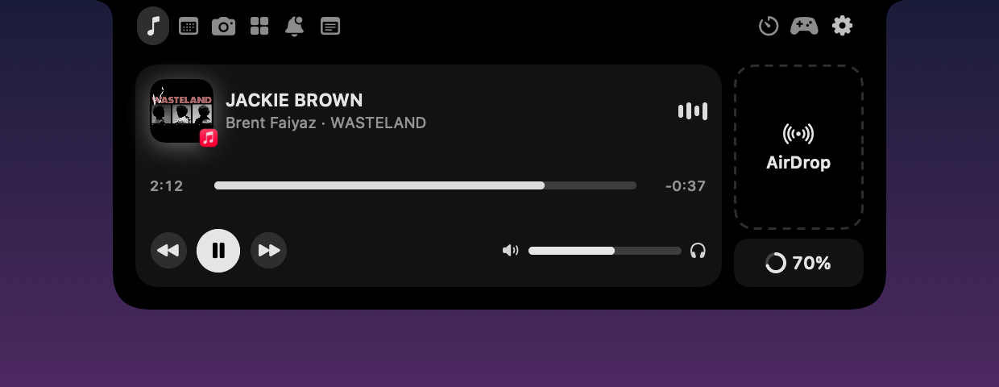
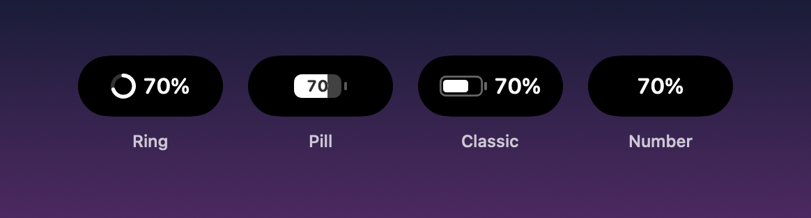
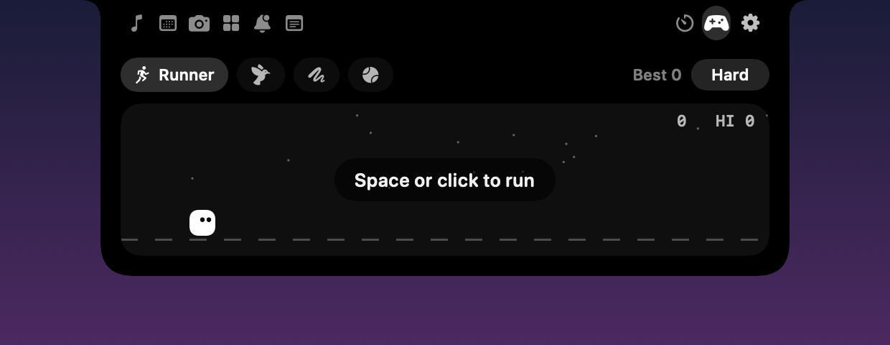
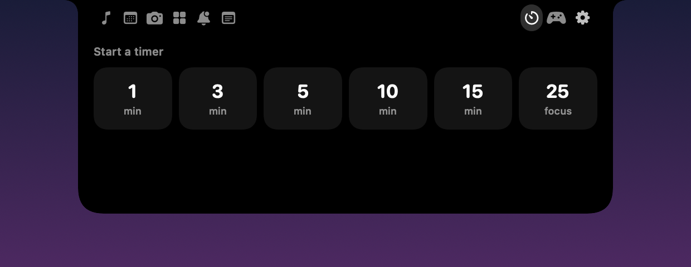
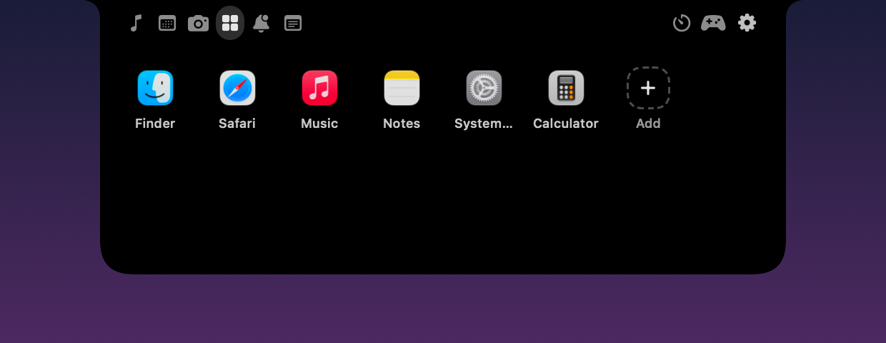

# NotchPal

**The notch that's alive.** NotchPal turns your MacBook's notch into an iPhone-style Dynamic Island, with music from any app, a camera mirror, live alerts, a pet and games built right in.

Free. Open source. No account, no tracking, no ads.

Made by **Mohammed Saif** · [LinkedIn](https://www.linkedin.com/in/saif-mohammed-939902335/) · [GitHub](https://github.com/MohammedSaif29)

**[⬇ Download NotchPal](https://github.com/MohammedSaif29/NotchPal/releases/latest)**



---

## Download and install

**You need:** a Mac with Apple silicon (M1 or newer) and macOS 14 Sonoma or newer. NotchPal works on Macs without a notch too: it becomes a small pill under the menu bar.

1. Open the **[latest release](https://github.com/MohammedSaif29/NotchPal/releases/latest)** and, under **Assets**, click **NotchPal-x.y.z.zip** to download it.
2. Double-click the zip to unzip it, then drag **NotchPal** into your **Applications** folder.
3. Double-click NotchPal to open it. macOS will say it can't verify the app. Click **Done**, not Move to Trash.
   This happens because NotchPal is free and isn't signed with a paid Apple developer account yet. The code is all here for anyone to check.
4. Open **System Settings → Privacy & Security**, scroll down to **Security**, and click **Open Anyway** next to NotchPal. Confirm with your password or Touch ID. You only do this once.
5. That's it. Move your pointer onto the notch to open the island. NotchPal also puts a small capsule icon in the menu bar, with Settings, About and Quit.

**If macOS says NotchPal "is damaged", or music doesn't show up:** open **Terminal** and run this, then open NotchPal again:

```bash
xattr -dr com.apple.quarantine /Applications/NotchPal.app
```

It removes the "downloaded from the internet" flag from NotchPal only.

**Permissions** are only asked for when you first use a feature: Camera for the Mirror, Calendar for your events, and Accessibility for notification counts. Music, battery, volume and AirDrop need none.

**Start at login:** Settings → General → Open NotchPal at login.

**Update:** when a new version is out, NotchPal tells you in the notch. Click **Update** and it downloads, checks and installs it, then restarts by itself. Your settings stay. You can also use the menu bar icon → Check for Updates. (Updating from 0.4.0? Download 0.5.0 once by hand; after that it updates itself.)

**Uninstall:** click the capsule icon in the menu bar → Quit NotchPal, then drag NotchPal from Applications to the Trash.

## What it does (v0.5)

**In the closed notch**
- **Music from any app** with album art and a visualizer tinted to the cover. Swipe sideways on the island to change songs.
- **Battery, your way**: show it always, unplugged, when low, or while charging. Pick a clean style (a thin Ring, an iPhone-style Pill, the Classic battery, or just the Number) with iPhone colours (white, green while charging, yellow in Low Power Mode, red when low) or any colour you like. Six emoji packs are there too, if you want something playful.
- **Pal, the notch pet**: dances to music, munches electricity while charging, sweats when the battery is low, and naps late at night. Choose Lively, Calm or Still.
- **Easy on the eyes**: brightness sliders for the closed notch and the open island, a soft white Pal, and Reduce Motion support.
- **Updates itself**: when a new version is out, the notch tells you. One click downloads it, checks it and restarts NotchPal, like an app update on your phone.
- **Stays out of your way**: the closed island never blocks clicks on the menu bar items next to it, and on Macs without a notch it stays hidden until you hover the top middle of the screen.
- **Privacy dots**: green while any app uses the camera, orange for the microphone, like iPhone.
- **Two live activities at once**: with music and a timer running, the timer splits into its own bubble.
- **Live alerts**: charging, low battery, AirPods, new song, meetings about to start (with a Join button), new messages, timer done.

**Widgets in the open island** (turn them on, off and reorder them in Settings, or right-click any icon in the island to hide or move it)
- **Music**: the same player for every app (Spotify, Apple Music, YouTube in your browser, VLC and more), with the app's icon on the album art, seek bar, play/pause, volume, screen brightness, speaker/AirPods picker, AirDrop and battery card. Choose which apps can show in the notch.
- **Calendar**: today's events with one-click Join for Zoom, Meet, Teams, FaceTime and Webex.
- **Mirror**: check yourself before a call, in a round or rectangle mirror right under the camera, with the camera's real proportions so your head is never cut off. Turn on Centre Stage, play Reactions (hearts, balloons, confetti…), switch cameras (like your iPhone), open Desk View, and see Portrait, Studio Light and Background at a glance, with macOS's Video Effects panel one click away. The camera is only on while the tab is open, and nothing is recorded.
- **Apps**: your favourite apps, one click away.
- **Notifications**: unread counts from Messages, WhatsApp, Mail, Slack and any other Dock app.
- **Notes**: a scratchpad that saves itself.
- **Timer** and **Games** (Runner, Flappy, Snake, Pong, each with Easy/Normal/Hard). Pick which games show up.

**Settings**
- Size: open width and length, corner roundness, closed wing width and height.
- Look: Black, Liquid Glass, Frosted or Clear, with darkness, tint colour, shiny edge, glass when closed, shadow and accent colour.
- Motion: Snappy, Smooth, Gentle, Liquid or Bouncy, and content that appears with a Blur, Fade, Slide or Pop.

## Pictures

The closed notch while music plays:


Battery styles, with iPhone colours:



Games, timers and your favourite apps:





These were made with NotchPal's own **Save Pictures of My Island…** (menu bar icon, or Settings → About). Use it to share your setup!

## Privacy, and how it works

NotchPal collects nothing. The only time it goes online by itself is to ask GitHub, once a day, whether there's a new version. That request contains nothing about you or your Mac, and you can switch it off in Settings → About. The links in About (LinkedIn, GitHub, Report a Problem) only open your browser when you click them.

- **Music**: since macOS 15.4 only Apple's own programs may read what's playing, so NotchPal runs a tiny helper inside `/usr/bin/perl` (an Apple program) to read the system's Now Playing info. If Apple blocks that, it falls back to asking Spotify and Apple Music directly.
- **Notifications**: macOS doesn't let apps read other apps' notifications. With the Accessibility permission, NotchPal reads only the unread counts on Dock icons, never message text.
- **Calendar** and **Mirror** only ask for permission when you first use them. The camera is off unless the Mirror is open, and nothing is ever recorded.
- **Privacy dots** only check whether the camera or microphone is in use. They never see or hear anything.
- **Battery, volume and speakers** use public macOS APIs and need no permissions.

## Help and support

- **Found a bug or have an idea?** [Open an issue](https://github.com/MohammedSaif29/NotchPal/issues/new/choose). In the app: menu bar icon → Report a Problem.
- **Want to reach me?** Message me on [LinkedIn](https://www.linkedin.com/in/saif-mohammed-939902335/).

## Build it yourself

You need macOS 14 or newer and the Xcode Command Line Tools (`xcode-select --install`).

```bash
git clone https://github.com/MohammedSaif29/NotchPal.git
cd NotchPal
bash Scripts/build-app.sh --run
```

That builds NotchPal, installs it to `~/Applications/NotchPal.app`, and makes a release zip in `dist/`.

For development, `bash Scripts/dev-watch.sh` rebuilds and relaunches the app every time the `.rebuild` file changes, and writes the output to `build.log`.

Want to help? See [CONTRIBUTING.md](CONTRIBUTING.md).

## Roadmap

- [ ] Download tracker (TeraBox, Chrome, Safari…)
- [ ] `notch push` command so any script or app can show a live activity
- [ ] Clipboard history
- [ ] Live cricket scores
- [ ] Notch-to-notch multiplayer Pong
- [ ] Signed and notarized releases, so installing takes one click
- [ ] Windows version

## Licence and name

Copyright © 2026 Mohammed Saif.

NotchPal is free software under the **GNU General Public License v3** ([LICENSE](LICENSE)). In plain words: anyone may use NotchPal for free, read its code, and change it. Anyone who shares a copy or a changed version must keep the copyright notice, credit the original, and share their version's code under the same GPLv3 licence. Nobody can turn it into a closed, paid app.

The name **NotchPal** and its icon belong to Mohammed Saif and aren't covered by the code licence. Copies and changed versions must use a different name and icon, and must not present themselves as the official NotchPal. See [TRADEMARKS.md](TRADEMARKS.md). The official NotchPal is only published at **github.com/MohammedSaif29/NotchPal**.
